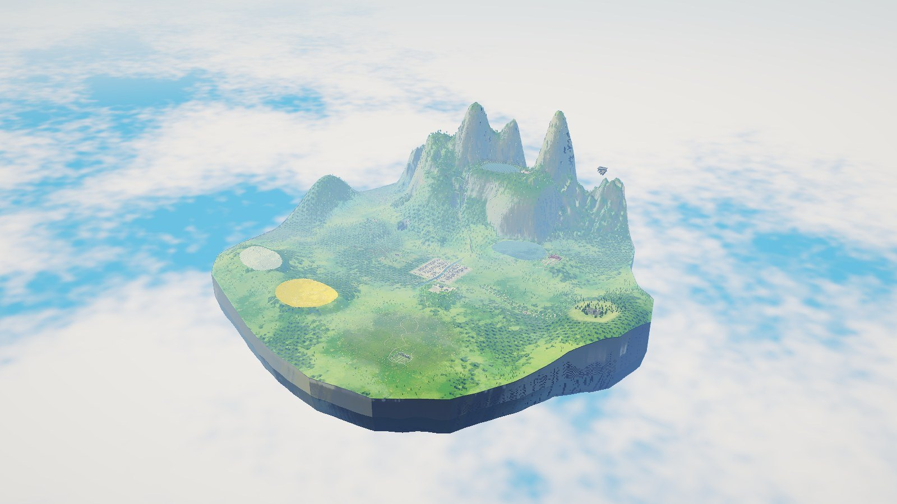
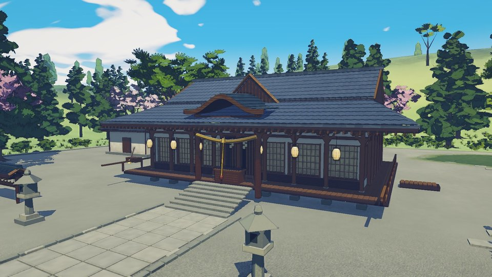
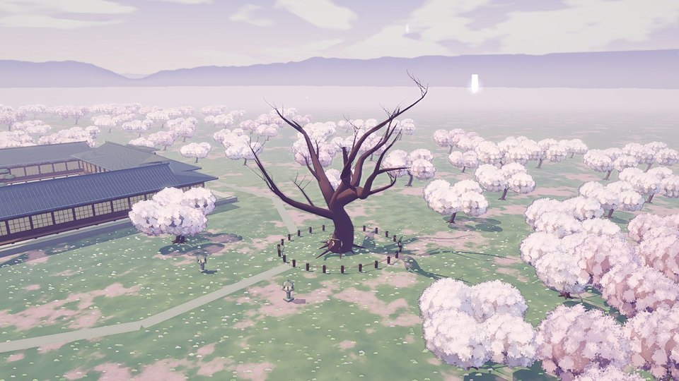
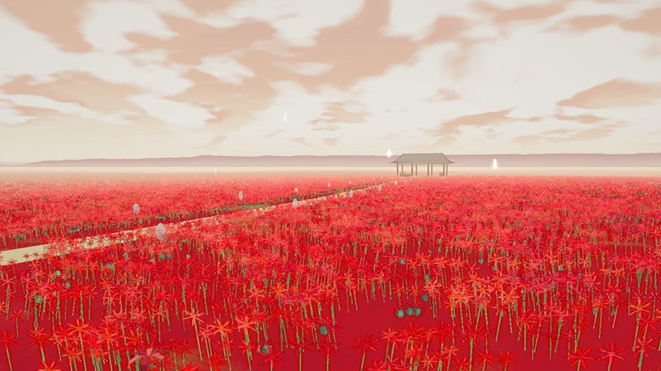
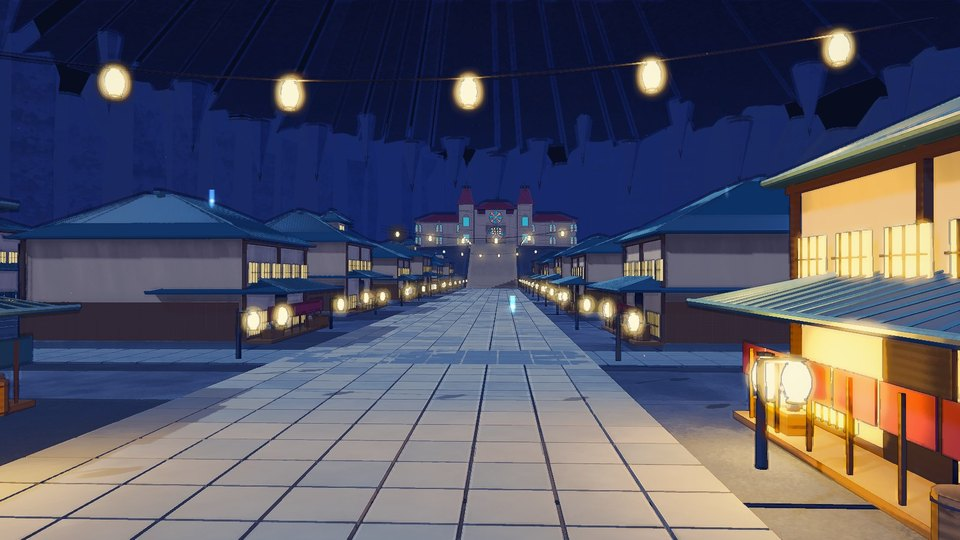
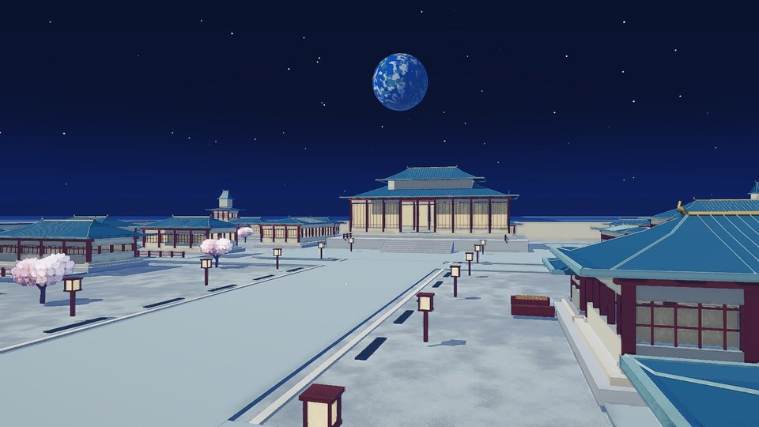
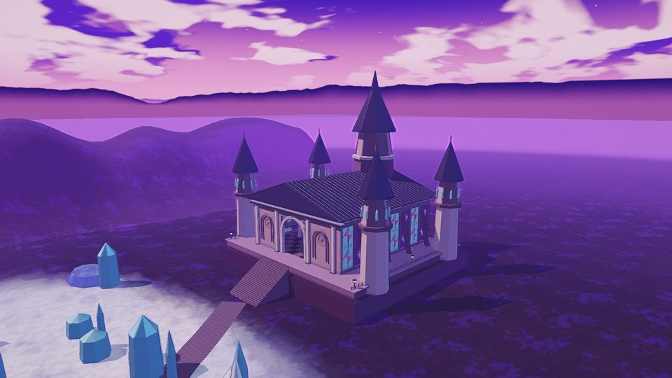

<div align="center">

# 幻想乡立体风物志

**TouhouGensokyoAtlas**

用 Three.js 搭建的东方 Project 幻想乡三维地图

[在线体验](https://tianyin231.github.io/TouhouGensokyoAtlas/) · [下载离线版](https://github.com/tianyin231/TouhouGensokyoAtlas/releases/latest) · [版本记录](docs/changelog.md) · [世界观与来源](docs/world-reference.md)

[](https://github.com/tianyin231/TouhouGensokyoAtlas/releases/latest)
[](https://github.com/tianyin231/TouhouGensokyoAtlas/actions/workflows/pages.yml)
[](https://threejs.org/)



</div>

幻想乡在这里是一整块浮在云海上的连续大地。神社、人里、魔法森林和妖怪之山之间有实际的土地、道路和林带相连，冥界、天界、月都、魔界等空间各自独立，可以随时进出。你可以从空中俯瞰全岛，也可以自由飞行，或者落到地面上沿路走。

所有场景都是代码生成的三维模型，地点标明出处。原作没有交代的部分标为 `P`（工程补完），不当作官方设定。

> 本项目是东方 Project 的非官方同人作品，与上海爱丽丝幻乐团没有关联。

## 画面

<table>
  <tr>
    <td width="33%"></td>
    <td width="33%"></td>
    <td width="33%"></td>
  </tr>
  <tr>
    <td align="center">博丽神社</td>
    <td align="center">冥界 · 西行妖</td>
    <td align="center">彼岸 · 彼岸花原</td>
  </tr>
  <tr>
    <td></td>
    <td></td>
    <td></td>
  </tr>
  <tr>
    <td align="center">旧地狱 · 旧都</td>
    <td align="center">月都</td>
    <td align="center">魔界 · 万魔殿</td>
  </tr>
</table>

以上均为 v0.30 实机截图，已隐藏界面。

## 可以去哪里

全图共 400 多个预设机位，下表列出主要空间。

| 空间 | 代表场景 | 机位 |
|---|---|---:|
| 地表 | 博丽神社、人间之里、魔法森林、雾之湖与红魔馆、迷途竹林与永远亭、妖怪之山与守矢神社、太阳花田、无缘塚 | — |
| 地底 | 旧都、地灵殿、灼热地狱、核聚变炉 | — |
| 伪天棚 | 残雪高地、花甸、驹草旧屋 | 13 |
| 虹龙洞 | 矿口、双轨浅层、深部矿脉 | 14 |
| 辉针城 | 外观、大殿、事件风暴、可逆剖览 | 8 |
| 冥界 | 幽明结界、长阶、白玉楼、西行妖 | 13 |
| 天界 | 有顶天桃林、要石、玄云海 | 14 |
| 彼岸 | 中有之道、赛之河原、三途河、彼岸花原 | 16 |
| 月都 | 城内、绵月宅、桃园、静海 | 14 |
| 魔界 | 法界、魔界街道、冰雪世界、万魔殿 | 19 |
| 畜生界 | 高楼都市、灵长园内外 | 16 |
| 后户之国 | 门群、四季窥景 | 14 |
| 华扇仙界 | 茨华仙邸、花庭、书室 | 14 |
| 现行地狱 | 骸原、业风、无间 | 14 |

## 操作

| 模式 | 操作 |
|---|---|
| 观察 | 左键拖动旋转，右键或 Shift 拖动平移，滚轮缩放 |
| 自由飞行 | 拖动环顾，WASD 移动，Q / E 升降，Shift 加速 |
| 地面行走 | 拖动环顾，WASD 行走，Shift 快走，滚轮调视野 |

顶部可以切换空间、搜索地点、查看人物和调整画质，右下角可以切换时间、天气和相机模式。鼠标停下几秒后控件会退下，移动鼠标就会回来。

## 建设进度

目录收录 179 个地点，其中 109 个已接入可浏览的场景，70 个已登记但还没有绑定场景。这是导航覆盖，不是竣工比例：接入场景不代表美术或室内已经完成。人物资料 85 条，原作图未核实时明确显示缺图，不用同人图或生成图代替。

目前已知的不足：

- 地区衔接、生机和体量还在继续改进，详见[画面方向重审](docs/art-direction-review.md)。
- 夜景目前只有博丽神社做过局部精调。
- 人物头像和资料链接可能访问外部网站，因此不算完全离线。

## 本地运行

需要 Python 3.10 或更高版本、Node.js 22.x（见 `.nvmrc`）和支持 WebGL2 的现代浏览器。构建和静态检查不需要安装 npm 或 pip 包，也不下载网络资源。

```powershell
python tools/build.py
node tools/check.mjs
python -m http.server 8765 --bind 127.0.0.1 --directory dist
```

打开 http://127.0.0.1:8765/ 后点击构建出的 HTML。请通过本地 HTTP 预览，避免各浏览器对 `file://` 下 Worker 等能力的差异。

构建会在 `dist/` 生成 `TouhouGensokyoAtlas-v0.30.html` 这样的版本化 HTML、`SHA256SUMS.txt` 和 `release.json`，后者记录本次输出和输入文件的校验值。这些文件都不提交到 Git。修改源码后要重新构建，刷新浏览器才能看到变化。

Node.js 24 的数学运算结果会使旧场景的逐字节几何基线不同，应切换到 22.x，不要重写基线。

引擎、地图数据和模型资源都内嵌在 HTML 里。浏览器回归脚本（`tools/check-*-browser.py`）需要 Playwright 和 Chromium，不是构建依赖。

## 项目结构

| 路径 | 内容 |
|---|---|
| `project.json` | 当前版本、发布标题、Three.js 版本及建模模块的拼接顺序 |
| `src/index.html`、`src/styles.css`、`src/app.js` | 页面模板、样式、地点选择、导览与启动逻辑 |
| `src/world-builder.js` | 基础数学、地形和已有地表区域的程序化建模 |
| `src/<地区>.js`、`src/<地区>-renderer.js`、`data/<地区>.json` | 各地区的建模、渲染与资料，例如 `netherworld`、`heaven`、`higan`、`lunar`、`makai` |
| `src/old-hell.js`、`src/old-hell-renderer.js` | 旧地狱的建模、地点映射、导览镜头与地下专用效果 |
| `src/renderer.js`、`src/camera.js`、`src/streaming.js` | 渲染与光照、相机操作、区域 Worker、缓存和资源释放 |
| `src/render-look.js`、`src/camera-feel.js` | 二次元动画背景画风 |
| `src/realm-look.js` | 画风在异界的延伸、隙间转场与机位修正 |
| `src/ui-theme.js` | 界面布局与样式 |
| `src/landmarks.js`、`tools/audit-landmarks.mjs` | 显式地点导航与同源核对报告 |
| `src/characters.js`、`data/characters.json` | 角色标记与角色资料 |
| `data/atlas.json`、`data/expansion.json` | 地点、来源、关系与扩展建模数据 |
| `assets/packs/*.pack.gz` | 必需的总览和旧场景源资源包，不是可删除的缓存 |
| `vendor/three/` | 固定版本的 Three.js 引擎与上游 MIT 许可证 |
| `preview/` | 少量代表性实景截图，不按每个版本批量归档 |
| `tools/build.py`、`tools/check.mjs` | 构建与发布前集成检查 |

## 参与维护

开始之前先读 [AGENTS.md](AGENTS.md)，里面有不可回退的需求和交付边界。下面几条最容易出错：

- **地图的基本形态：** 正常天空、日光和天气下的一整块连续大空岛。岛内保留地区之间的土地、道路、林缘与坡地过渡，虚空只在外围。地下采用可逆剖切或独立空间，不能改成黑色展厅中的多个独立空岛。
- **只改源码：** 只修改源码和源资源，不修改 `dist/` 中的成品，也不恢复“以上一版 HTML 为输入”的构建方式。旧命令 `tools/build_v017.py` 已由 `tools/build.py` 替代。
- **新增模块：** `src/index.html` 中的 `{{...}}` 是构建占位符。新增建模模块时按依赖顺序加入 `project.json` 的 `worldBuilders`，构建会把同一份代码分别内嵌给主线程和 Worker，不维护两个副本。
- **近景和总览分开：** `assets/packs/` 是 gzip 压缩的二进制包，内含 JSON 清单和数组数据。当前构建只校验和内嵌它们，不会从建模代码自动重建总览。修改地形或建筑后，要分别检查近景和总览。
- **地点与来源：** 地点 ID 是检索、角色关联和导览的连接键，新增或改名时要同时核对相关映射。不要删除资料来源，也不要把标记为 `P` 的工程补完改成官方事实。
- **版本号：** 当前版本由 `project.json` 统一决定，格式如 `0.30.0`。末段为零时标签为 `v0.30`，否则如 `0.30.1` 对应 `v0.30.1`。页面标题、版本显示和下载名称由构建填入。数据里的资料版本、区域版本和历史来源说明有独立含义，不要全局替换旧版本号。
- **Three.js：** 升级时 `three.core.js` 与 `three.module.js` 必须来自同一上游版本，同时更新 `threeRevision` 和许可证。不要让构建临时从 CDN 获取“最新版本”。

提交前运行构建和检查，再通过浏览器检查地表总览、旧地狱、地点定位及返回地表。检查脚本会拒绝过期成品、部分无效资源、脚本语法错误和被 Git 跟踪的发布 HTML，实际画面仍需要浏览器验收。

<details>
<summary>在浏览器 Chat 中继续优化</summary>

把仓库链接与以下提示一起交给新会话。需确保该会话确实能读取当前分支，不能假定聊天会自动加载 `AGENTS.md`。没有仓库读取能力时，提供对应文件内容后再继续。

```text
请继续优化 https://github.com/tianyin231/TouhouGensokyoAtlas 的【填写区域】。
先读取当前分支的 AGENTS.md、project.json、docs/current-status.md、
docs/art-direction-review.md、docs/visual-upgrade.md，再核对目标区域源码、
已有美术/工程规范及必要考据。审美问题以 art-direction-review.md 为准。
保留远端新增地区和博丽神社试点成果，不从旧聊天或历史 HTML 覆盖当前工程。
先用真实浏览器查看总览、近景、背面和连接路，说明质感问题的具体原因，
再小步实施，兼顾性能和周边过渡；有能力时直接完成构建及视觉验证。
如未实际读到源码或无法运行浏览器，请明确缺口，不把推测写成已验证。
只报告本次实际变化、验证结果与剩余限制；提交前再核对远端更新。
```

</details>

## 提交与发布

日常提交维护同一套源码，Git 提交保存修改记录，标签标记正式版本。不需要把各版本的完整 HTML 长期放在主分支。

在线体验跟随 `main` 分支，可能包含尚在打磨的内容。推送后，`.github/workflows/pages.yml` 自动运行构建和检查，将通过检查的 HTML 以 `index.html` 发布到 GitHub Pages，也可在 Actions 中手动运行。仓库 Settings → Pages 的 Source 应保持为 **GitHub Actions**。不要改成从源码分支直接发布，也不要把 `dist/` 或网站成品提交到 Git。构建或检查失败时，本次更新不会发布，可在 Actions 中查看原因。

网站部署与正式 Release 相互独立：更新网站无需创建标签或覆盖已有附件。Pages 仅上传 `dist/pages/`，临时部署制品保留 1 天，这不影响已上线的网站。

正式版本的发布顺序：更新版本与内容 → 构建和检查 → 浏览器验收 → 提交并推送源码 → 创建并推送标签 → 上传本次 HTML 与校验文件。

下面以 `v0.30` 为例。后续发布请按 `dist/release.json` 中的 `tag` 和 `artifact` 替换，不重复使用已发布的标签：

```powershell
python tools/build.py
node tools/check.mjs
git status --short
git add src data assets vendor tools project.json README.md AGENTS.md .gitignore .gitattributes
git commit -m "发布 v0.30 画风重整"
git push origin main
git tag -a v0.30 -m "v0.30 画风重整"
git push origin v0.30
gh release create v0.30 dist/TouhouGensokyoAtlas-v0.30.html dist/SHA256SUMS.txt --verify-tag --title "v0.30 画风重整" --notes-from-tag
```

发布需要 GitHub CLI 已登录且有仓库写入权限。附件使用 ASCII 文件名，避免 GitHub 自动改名后与校验文件不一致。上传时指定本次产物，不使用 `dist/*.html`，避免上传遗留的其他版本。不要移动已发布标签或覆盖 HTML 内容，场景修订后发布新版本。

## 文档

| 文档 | 内容 |
|---|---|
| [AGENTS.md](AGENTS.md) | 当前维护约定、不可回退的需求、验证与交付边界 |
| [版本记录](docs/changelog.md) | 各版本的内容、模块、可选回归和仓库迁移记录 |
| [当前状态与实现覆盖](docs/current-status.md) | 当前仓库结构、已建地表与地下、尚未完成的部分 |
| [画面方向重审](docs/art-direction-review.md) | 用户判定的审美问题与定稿画风，审美问题以此为准 |
| [画面升级策略与神社试点](docs/visual-upgrade.md) | 画面标准、性能与过渡策略、逐区实施与视觉核验 |
| [需求与决策记忆](docs/project-context.md) | 用户要求、参考图意图、已否定方案、历史交付教训 |
| [世界观、地理与来源](docs/world-reference.md) | 地区关系、研究锚点、时代与空间区分、原作与同人出处 |
| [v0.29 剩余目录与原作出处](gensokyo-v029-remaining-origins.md) | v0.29 时未绑定目录的分组、出处与补建边界，选区前要结合当前源码复核 |
| [美术与建模规范](docs/art-and-modeling.md) | 场景层次、建筑差异、连接地带、植物、材料、灯光和动态标准 |
| [工程架构与性能约定](docs/engineering.md) | 构建链、源资源、按区生成、CPU 与 GPU 回收、渲染与统计口径 |
| [开发、验收与发布流程](docs/development-workflow.md) | 防止地区丢失、检查器边界、视觉回归、干净提交和有效交付 |

各地区的考据放在 `docs/*-reference.md` 和 `docs/*-handoff.md`。这些文档保存当前决策与来源，不保存旧版成品合集。需求或实现改变时更新对应章节，不要给每个版本再复制一套文档。

## 权利说明

`vendor/three/LICENSE` 仅适用于 Three.js。东方角色、原作图片和引用资料的权利说明见各数据源，本仓库没有因此重新授权它们。
