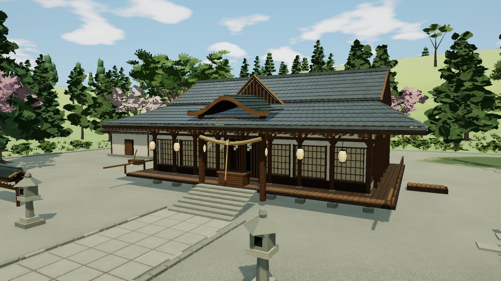
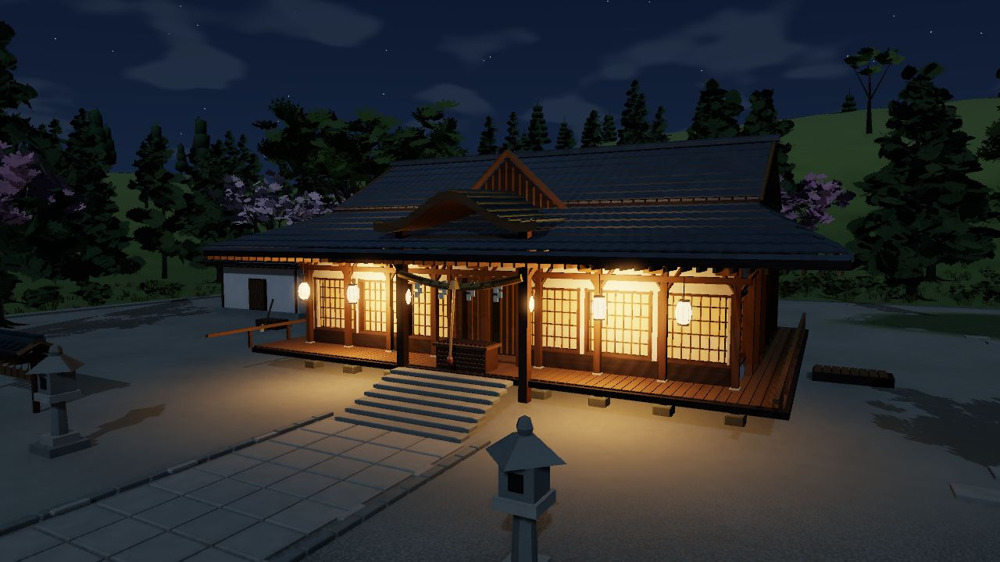

# 版本记录

各版本的内容、模块与边界。这些说明原本放在 README 里，现在集中到这里，文字保持当时的说法。其中的目录数字都是当时的数字，当前数字以页面和 `node tools/audit-landmarks.mjs` 为准。

## 画风重整（0.30.0）

- **画风：** 定稿二次元动画背景画风（`src/render-look.js`、`src/camera-feel.js`），并延伸到地表以外的全部空间（`src/realm-look.js`）。
- **穿帮：** 修了魔界钟楼悬空的石块、冥界旧幽灵多面体、仙界山石顶上的黑洞、瀑侧登山道被岩肋压住，以及 10 个钻进墙体、树冠或地面的机位。
- **转场：** 切换空间时播放隙间转场，新场景就绪后才打开。
- **界面：** 改成浮在画上的细字，鼠标停下后控件退下（`src/ui-theme.js`）。

方向与做法见[画面方向重审](art-direction-review.md)，验收状态见[当前状态](current-status.md)。这一版的美术接受不等于内容完成：地区衔接、生机和体量仍在继续做。

## 逐区画面升级：博丽神社试点

在 v0.29 高地版本上合入神社的木石瓦材质、立面进深、枝叶与庭院植被、周边林带过渡，以及可切换的月光夜景。晴天仍为默认；夜晚的暖灯与纸门目前仅对神社精调。后续区域按[画面升级策略](visual-upgrade.md)逐步推进，保留各自建筑和环境特色。

## 伪天棚与驹草旧屋（0.29.0）

顶部「伪天棚」进入与原山地连续相接的残雪高地、花甸和三间旧屋。赌场提供开设、散场、室内、背面、龙形烟管及可恢复剖览，共13机位；仅选择一间旧屋示意，不是永久营业、自动轮换或赌博玩法。山路贴合原近／远地形，详情回收后地面与路径仍在。矿道导览沿用原虹龙洞，不宣称已完成从地表无缝入洞。

新增`src/highland.js`、`src/highland-renderer.js`、`data/highland.json`，以及[来源与P补完边界](highland-reference.md)。本轮只增加伪天棚、赌场2个目录入口和山如1条关联，179条中93可导航／86待处理，人物85条；不是竣工比例。原作肖像未核时继续明确缺图。可选回归：`python tools/check-highland-browser.py`。原地区、源包、相机功能与Pages工作流保留。

## 保留场景：虹龙洞矿道（0.28.0）

顶部「虹龙洞」进入矿口、双轨浅层、道岔空车、采样工作点、东支巷和深部矿脉，共14机位；支持洞顶剖览和TH18.5充氧状态。只有局部洞口背景，不算完整伪天棚、赌场或从地表走入矿井。轨道、空心矿车、支护和背面都是P几何补完，与地灵虹洞不同。

[考据与范围](rainbow-mine-reference.md)区分原作、社区索引和具名同人。目录179条中91可导航、88待处理；新增魅须丸与百百世后人物84条，未核原作肖像仍明确缺图。源码模块为`src/rainbow-mine.js`、`src/rainbow-mine-renderer.js`和`data/rainbow-mine.json`；可选测试`python tools/check-rainbow-mine-browser.py`。保留原地区、相机与Pages。

## 保留场景：现行地狱与无间选景（0.27.0）

顶部「现行地狱」进入TH17骸原、风蚀地层与猩红业风，另有《茨歌仙》无间暗处及TH19人物关联机位，共14机位。它不同于旧地狱的街区、宫殿与熔岩设施；没有虚构总部、固定地表入口或可穿越的跨界通道。骨壳、眼窝、肋架和地层为真实三维几何，路线与数量标P。

[考据与实现边界](current-hell-reference.md)分开记录原文转录、场景索引与同人排除对照。只接入原目录`hell`，现为179条中90可导航、89待处理，人物82条；不是竣工比例。新模块`src/current-hell.js`、`src/current-hell-renderer.js`和`data/current-hell.json`，可选回归`python tools/check-current-hell-browser.py`。原全部地区、相机和Pages保留。

## 保留场景：华扇仙界与茨华仙邸（0.26.0）

顶部「华扇仙界」进入独立山居，14个机位包含三层中式宅邸、真实圆窗书室、环廊与背面、花庭曲径、木桥涧水、开放鸟栖、夜庭、水墨选景及可恢复剖览。第48话八芒星只为事件示意，不实现去往地狱的传送。房屋尺寸、庭院与入庭路线均为P，不在妖怪之山地表猜测入口。

新增`src/kasen.js`、`src/kasen-renderer.js`、`data/kasen.json`，以及[来源、实现与验收边界](kasen-reference.md)。基于`126b822`，完整保留畜生界、后户之国、林缘、路线导览、地面行走／自由飞行及Pages部署。目录为179条中89可导航／90待处理，人物79条；导航数不是竣工比例，未核原作肖像继续明确缺图。

构建和目录检查命令不变，新增可选`python tools/check-kasen-browser.py`。CI运行本区域与公共回归，结果以对应运行记录为准；先前快速切回神社的着色器问题未被本次选定路径检查证明全面解决。

## 保留场景：后户之国（0.25.0加入）

顶部「后户之国」进入TH16绿色门群，14机位覆盖四季窥景、门背合页、二童子活动处、座席、上下纹样、第六面黑暗串门和Extra选景。四季窗口是本作三维小景的一次性离屏渲染，不是实时地表传送门；门与上层地面可关闭／恢复。布局、尺寸及座席保留P标记。

基于已合并的`b25a778`追加，原畜生界、林缘景观、路线导览、地面行走、自由飞行及Pages配置全部保留。0.25版本时179条目录中87可导航、92待处理；人物78条，新增三人未核原图明确显示缺图。新模块为`src/backdoor.js`、`src/backdoor-renderer.js`与`data/backdoor.json`，具体[依据、四季窗口预算与边界](backdoor-reference.md)可查。

构建与静态检查命令不变；可选新回归为`python tools/check-backdoor-browser.py`。CI对本次区域和公共回归通过HTTP检查，其结果以每次运行记录为准，不把工作流存在当成通过。旧的快速切换着色器问题不因本轮选定测试通过而宣称已修复。

## 保留场景：畜生界与灵长园（0.24.0加入）

0.24候选经PR #1合并到主分支，包含其后整合的林缘和相机功能；当时以合并后的`b25a778`继续开发。此前快速未同步切回博丽神社的着色器校验错误仍未确认根因，详见[当前状态](current-status.md)，不因合并或本轮检查通过而改称已修复。

顶部「畜生界」进入高楼都市与锁孔形林地；导航可切到电子遗产内景。16个机位覆盖街巷、退台楼顶、土垒、守备口、陶偶、制作区、高廊与可逆剖览。TH17袿姬时期与改造前意象分开；后者不代表完整历史地图。新建筑与室内均为P补完，不给普通大楼命名组织总部。

新增`src/animal.js`、`src/animal-renderer.js`、`data/animal.json`及[出处与边界](animal-reference.md)。原73位人物及全部旧场景保留，新增磨弓、袿姬；原作图未核时明确显示。0.24目录为179项中的86可导航／93待处理，不是竣工比例。可选浏览器检查：`python tools/check-animal-browser.py`。

## 保留场景：彼岸与三途河（0.23.0加入）

顶部「彼岸」进入中有之道摊街、赛之河原、三途河渡口和彼岸花原；共16机位，两岸分别导览，不设跨河桥或固定渡河里程。码头、空心木舟、石堆风车、反卷红花与无专名关口均为真实几何。关口不是是非曲直厅总部，布局和背面保留P标记。

[考据与范围](higan-reference.md)记录原作文字、同人预览与补完区别。0.23版本时目录为179条中84可导航、95待处理，不是竣工比例。新增 `src/higan.js`、`src/higan-renderer.js`和`data/higan.json`，原地区与源资产不改。可选回归为`python tools/check-higan-browser.py`；`.github/workflows/scene-check.yml`以只读权限独立重建并运行HTTP浏览器检查，短期附件不替代正式Release。

## 保留场景：天界与玄云海（0.22.0加入）

顶部「天界」进入有顶天桃林与花原、临云小亭、要石、玄云海山顶岩地；14机位包含背侧／岩基、局部绯云征兆、宴席和TH155土石极光选景。在0.22版本时，三项已有目录接入后为 **80条可导航、99条待处理／共179条**，不是竣工比例。未把天界合并到神子仙界、月都或幻想乡地表。

新模块为 `src/heaven.js`、`src/heaven-renderer.js`、`data/heaven.json`。小亭、路形、岩基、未见立面与所有尺寸标P；TH105与TH155场景不同时叠加。[考据、版本边界与预算](heaven-reference.md)可查。构建检查命令不变，新增可选 `python tools/check-heaven-browser.py`，原作图仍按真实加载状态显示。本轮不自动创建Release。

## 保留场景：冥界与目录修正（0.21.0加入）

顶部「冥界」进入幽明结界、长阶、白玉楼和西行妖，共13个机位。白玉楼采用コ字形本殿、枯山水中庭与低墙外樱庭；西行妖默认封印不开花，花苞事件、雪庭和本殿剖览均可恢复。[依据与P补完边界](netherworld-reference.md)单独记录。

同时补上8条已有模型的目录绑定，取消幻想风穴／山麓间歇泉／圣域3条错误邻区回退。在0.21版本时，179条中77条可导航、102条待处理，**这是导航覆盖，不是竣工比例**。`node tools/audit-landmarks.mjs`生成与界面使用同一解析器的完整核对表。新增源码、资料与测试；原地表、旧地狱、辉针城、月世界和魔界不重建覆盖。

## 保留场景：魔界（0.20.0加入）

顶部「魔界」进入：星莲船的红黑封印与法界、怪绮谈的洞口／街道／冰雪世界／万魔殿、灵异传的维纳废墟与堕落神殿。共19个机位，万魔殿包括大堂、侧廊、后庭和可逆剖览。按作品分图展示，不主张它们是三个不同的官方宇宙，也不悬置在幻想乡上空。

新增 `src/makai.js`、`src/makai-renderer.js`、`data/makai.json`；[来源与P补完边界](makai-reference.md)单独记录。离线构建与检查命令不变，可选浏览器回归为 `python tools/check-makai-browser.py`。原地表、旧地狱、辉针城和月世界源资产保留。本轮直接推送源码，不自动创建Release。

## 保留场景：月世界（0.19.0加入）

顶部「月之都」进入城内、绵月宅、桃园和丰富海；底部可切换静海表里与第四槐安通道，也可返回完整幻想乡。共有14个机位，封存事件与日常场景分开。不是把月都悬在地表上空。

新增 `src/lunar.js`、`src/lunar-renderer.js` 与构建资料补丁 `data/lunar.json`。旧地点及人物源数据不覆盖；详细身份与边界见 [月世界考据与实现](lunar-reference.md)。集成检查仍为 `node tools/check.mjs`，另有可选 `python tools/check-lunar-browser.py`；浏览器脚本需要Playwright／Chromium，不是构建依赖。

## 保留场景：辉针城（0.18.0加入）

顶部“辉针城”或地区下拉菜单进入。提供外观、空中来路、背侧、石垣、望楼、大殿、可逆剖览和事件风暴八个机位；地点检索也支持“逆城”与“Kishinjou”。TH145三层外形与TH14逆向室内的依据、版本差异、同人参照和P补完见[辉针城考据与实现](kishinjou-reference.md)。这次更新源码，不自动创建或覆盖Release；构建后才能看到新场景。

## 仓库迁移记录

首次 `v0.17` 标签中的构建工具输出中文文件名，Release 附件已统一为 ASCII 名称，HTML 内容的 SHA-256 相同。当前主分支已直接生成 ASCII 名称，后续版本遵循上述流程。

本次结构迁移保留初始提交历史，只让完整 HTML 退出当前分支的跟踪。原本地 HTML 可作为个人备份，但不再参与构建；全新克隆无需下载旧 Release，也能独立构建。

`.gitignore` 和普通删除不会清除已经提交的历史内容。当前迁移的作用是停止以后继续累积整包 HTML，不宣称已经清空历史占用。历史重写应作为独立迁移处理，不混入日常发布。
